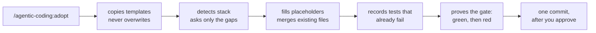

# agentic-coding-resources

Reusable practices, templates, and skill playbooks for coding with AI agents (Claude Code,
Codex, Cursor, and others), distilled from building and reviewing a production
multi-tenant platform with agents.

The aim is one idea: **make "done" mean the same thing for a human and an agent**, and make
that definition mechanical, cheap to run, and impossible to skip.

## Quick start (any repo, legacy or new)

Install the plugin once, in Claude Code:

```
/plugin marketplace add alihssan/agentic-coding-resources
/plugin install agentic-coding@agentic-coding-resources
```

Then, in any project:

```
/agentic-coding:adopt
```

That's it. The skill brings its own templates, so there is nothing to clone or copy by hand.



- **Safe on legacy repos.** Nothing is overwritten. If you already have a `CLAUDE.md` or
  `.claude/settings.json`, the template is staged in `.agentic/incoming/` and merged into
  yours, keeping your content.
- **Legacy test suites with failures are fine.** Today's failures are recorded in
  `tests/known_failures.txt`, so the gate starts green and fails only on *new* breakage. Lint
  is checked on changed files only, so old lint noise never blocks you.
- **New projects with no tests yet are fine too.** The gate passes on zero tests until you
  write the first one.
- **Nothing outward happens without you.** It works on a branch and asks before it commits.
  It never pushes.

After that, the day-to-day loop is: plan with `condensed-plans` → build with
`gate-driven-slices` → `adversarial-review` before a PR. See [`workflow.md`](workflow.md).
Those skills are also copied into the project's `.claude/skills/`, so teammates without the
plugin get them too.

### Without the plugin
- **Other Claude Code setups:** copy `skills/adopt/` (the whole folder) into
  `~/.claude/skills/`, then run `/adopt`.
- **Other agents (Codex, Cursor, …):** clone this repo and tell the agent *"Follow
  `<clone>/skills/adopt/SKILL.md` for this repo."*

## What's here

| Path | What it is |
|---|---|
| [`PRINCIPLES.md`](PRINCIPLES.md) | The principles. Read this first. Stack-neutral, each with a worked example. |
| [`workflow.md`](workflow.md) | The end-to-end flow: idea → slice → gate → review → PR → deploy, and where each skill fits. |
| [`skills/adopt/`](skills/adopt/) | One-time setup skill. Holds the drop-in [`templates/`](skills/adopt/templates/) (`AGENTS.md`, `CLAUDE.md`, `REVIEW.md`, the `check.sh` gate, `.claude/` config) and the script that copies them in. |
| [`skills/`](skills/) | Day-to-day playbooks: gate-driven slices, adversarial review, security audit, memory discipline, condensed plans. |
| [`skills/aws-terraform/`](skills/aws-terraform/) | Terraform on AWS: numbered rules with reasons (AWS Prescriptive Guidance + a read of `terraform-aws-modules`), pitfalls in popular modules, an infra gate (`check-terraform.sh`: fmt, validate, tflint, trivy, mocked `terraform test`), root and CI templates with an OIDC plan/apply split, and a worked module. `adopt` copies it only into repos that use the AWS provider. |
| [`.claude-plugin/`](.claude-plugin/) | Makes this repo a Claude Code plugin and its own marketplace. |

## Adopting by hand (what `adopt` automates)

1. Copy `skills/adopt/templates/` into the repo root and work through every `<PLACEHOLDER>`
   in `AGENTS.md` and `scripts/check.sh`. These two files carry most of the value: the
   agent's standing instructions, and the one command that decides "done".
2. Keep `AGENTS.md` tool-neutral; let `CLAUDE.md` (or your tool's equivalent) import it and
   add tool-specific notes.
3. Wire the skills you want from `skills/` into your agent (as plugin skills, `AGENTS.md`
   references, or copy the playbook text).
4. Set the permission guardrails in `.claude/settings.json`: **ask** before any write to
   shared state (commit, push, PR, merge), **deny** anything that touches production.

Nothing here is specific to one language or framework. The examples (a Python / FastAPI
multi-tenant service) are there only to make each pattern concrete.
