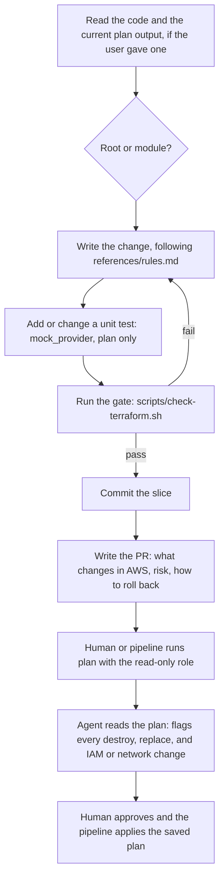

# AWS Terraform

Terraform changes real infrastructure. A wrong change can delete a database or open a port
to the internet. So this skill puts two things first:

1. **A mechanical gate** that every change must pass before a human sees the plan.
2. **A hard line**: the agent writes code, runs the gate and reads plans. A human (or the
   approved pipeline) applies.

The rules come from the AWS Prescriptive Guidance "Terraform AWS Provider best practices"
and from a read of the `terraform-aws-modules` repositories (13 repos, 2026-11). Each rule
in [`references/rules.md`](references/rules.md) says why it exists.

## The agent must never

- Run `terraform apply`, `destroy`, `import`, `state *`, `force-unlock`, `taint`, or
  `workspace delete`. Put a `moved`, `removed` or `import` block in the code instead.
- Run an `aws` CLI command that creates, changes or deletes anything.
- Read a secret value (`aws secretsmanager get-secret-value`, `aws ssm get-parameter
  --with-decryption`, `terraform output` of a sensitive value, a state file).
- Run `terraform plan` against a real account unless the user asks. Then use the read-only
  plan role, and say which account and backend it used.
- Change a backend block, a state key or `allowed_account_ids` without asking.
- Weaken a check to get green: no `#trivy:ignore`, `tflint-ignore` or `expect_failures`
  added just to pass, unless the user agrees and the reason is in a comment.

Add these to `.claude/settings.json` `deny` (the `adopt` template already denies apply,
destroy, import and state):

```
"Bash(terraform force-unlock:*)", "Bash(terraform taint:*)", "Bash(terraform workspace delete:*)",
"Bash(aws * delete*)", "Bash(aws * create*)", "Bash(aws * put*)", "Bash(aws * update*)",
"Bash(aws secretsmanager get-secret-value:*)", "Bash(aws ssm get-parameter* --with-decryption*)"
```

## First: which kind of code is it?

| | Root config (you run `plan` here) | Reusable module (others call it) |
|---|---|---|
| `provider` blocks | Yes, in `providers.tf`, with `allowed_account_ids` and `default_tags` | **Never** |
| Version constraints | `~> 6.0` (upper bound) | `>= 6.0` (floor only) |
| `.terraform.lock.hcl` | Commit it | Do not commit it |
| `backend` block | Yes, S3 with `use_lockfile = true` | Never |
| Per-environment values | `envs/<env>/terraform.tfvars` | No. Callers pass them. |
| `examples/` | No | Yes, runnable, with a README |
| Tests | `tests/*.tftest.hcl` | `tests/unit.tftest.hcl` + `tests/integration.tftest.hcl` |

If you cannot tell, look for a `backend` or `provider` block. If it has one, it is a root.

## Workflow



1. **Read first.** Read the module, its callers and its tests. For a root config, find the
   backend, the provider blocks and the environments.
2. **Write the change** in slices (see the `gate-driven-slices` skill). Each slice passes
   the gate alone.
3. **Test it.** Every new variable rule, precondition or computed value gets a run in
   `tests/unit.tftest.hcl`. A bug fix gets a test that fails first. See
   [`templates/tests/unit.tftest.hcl`](templates/tests/unit.tftest.hcl).
4. **Run the gate.** `scripts/check-terraform.sh` (copy it from
   [`templates/scripts/check-terraform.sh`](templates/scripts/check-terraform.sh)). It runs
   fmt, init without a backend, validate, the `sensitive` check (rule S10), tflint with the
   AWS ruleset, trivy and the unit tests, in every changed Terraform directory. Unit tests
   run with all AWS credentials removed, so an unmocked provider fails instead of calling
   AWS. `CHECK: PASS` is the only "done".
5. **Read the plan, when there is one.** Use the plan review list below. Say plainly what
   will be destroyed or replaced.
6. **Hand over.** The PR says what changes in AWS, the risk, and how to roll back. It never
   says "applied" unless a human told you that it was applied.

## Plan review list

Read `terraform show -json plan.out` or the plan text, and report each of these:

- **Destroy or replace** (`-/+`, `delete`). Name each resource and the attribute that
  forces the replacement. A replaced database, bucket, key, or volume can lose data.
- **Index shifts.** A list keyed by `count` index that changes length moves every item
  after the change. Fix it with `for_each` and `moved` blocks before anyone applies.
- **IAM.** Any new `Action: "*"`, `Resource: "*"`, `iam:PassRole`, or trust policy change.
- **Network.** Any new `0.0.0.0/0` or `::/0` ingress, a public IP, a public endpoint, or a
  changed route.
- **Data safety.** `deletion_protection`, `skip_final_snapshot`, `force_destroy`,
  `prevent_destroy`, backup retention, encryption settings.
- **Drift.** Changes the code did not ask for. Somebody changed AWS by hand. Do not
  "fix" drift silently. Report it.
- **Unknown values.** Large `(known after apply)` sets that hide what will change.
- **Secrets in clear text.** Any value that looks like a password, token or key and is not
  shown as `(sensitive value)`. That means a missing `sensitive = true` or a Helm `set` that
  should be `set_wo` or `set_sensitive`. Do not copy the value into the PR.

## The rules in short

Full list with reasons: [`references/rules.md`](references/rules.md). Mistakes seen in
real, widely used modules: [`references/pitfalls.md`](references/pitfalls.md).

- **Layout.** `main.tf`, `variables.tf`, `outputs.tf`, `versions.tf`, `locals.tf`,
  `providers.tf` (root only), `tests/`, `modules/<name>/`, `examples/<name>/`.
- **A module names a capability.** If the best name is the resource type
  (`s3-bucket`), use the resource directly. Nest one or two levels at most.
- **Small interface.** Every variable has a type and a description. Required variables
  have no default and `nullable = false`. Put limits in `validation` blocks, not only in the
  description. Units in names (`_gb`, `_days`). Positive booleans (`enable_*`).
- **Outputs come from resources**, never from input variables, so callers get a dependency.
- **`for_each` with stable keys** for anything that comes from a list. `count` only for
  0-or-1.
- **Attachment resources.** One `aws_vpc_security_group_ingress_rule` per rule,
  `aws_iam_role_policy_attachment`, separate `aws_s3_bucket_*` resources. Never manage one
  object from two places.
- **Safe defaults.** Encryption on, public access off, `deletion_protection = true`,
  final snapshot on, egress limited. The caller opts out, in writing.
- **Secrets never reach state.** Service-managed passwords first
  (`manage_master_user_password = true`). Otherwise an `ephemeral` resource plus a
  write-only `*_wo` argument with `*_wo_version`. `sensitive = true` does **not** keep a value
  out of state. Never read a secret with a data source.
- **Mark every secret sensitive, everywhere it passes** (in addition to the rule above).
  `sensitive = true` on every secret variable and output, `sensitive(...)` on locals built
  from secrets, Helm values in `set_wo` (write-only) or `set_sensitive`, never `set`.
  `nonsensitive()` only with a comment that gives the reason. The gate checks names that
  look secret. A block that is not a secret opts out with `# not-secret: <reason>`.
- **Factory pattern for many of the same thing.** Three or more instances of one shape
  (queues, buckets, roles, parameters) come from one `map(object({...}))` keyed by a stable
  name, merged with `optional()` defaults, with one `for_each` over a normal child module and
  map outputs. Not for one instance. No secrets in the spec map. See
  [`example/log-archive-factory/`](example/log-archive-factory/).
- **Provider guard.** `allowed_account_ids` in every `provider "aws"` block. `default_tags`
  for shared tags. No `profile` in shared code.
- **State.** S3 backend, `use_lockfile = true` (Terraform >= 1.11; DynamoDB locking is
  deprecated), `encrypt = true` with a KMS key, versioning on, one backend per environment.
- **Refactors go through code.** `moved`, `removed { lifecycle { destroy = false } }` and
  `import` blocks, reviewed in the PR.
- **Pin everything.** Root: `~>` for providers and the committed lock file. CI uses
  `init -lockfile=readonly`. Registry modules use an exact `version`. CI actions use a
  commit SHA.
- **Plan and apply are different identities.** CI uses GitHub OIDC. A read-only role plans
  on every PR. An apply role, limited to `main` and a protected environment, applies the
  saved plan. See [`templates/.github/workflows/terraform.yml`](templates/.github/workflows/terraform.yml).

## Setting up a repo

Copy what the repo does not have yet. Never overwrite a file that exists. Merge into it.

| Template | Goes to | Fill in |
|---|---|---|
| `templates/scripts/check-terraform.sh` | `scripts/check-terraform.sh` | Nothing. Call it from `scripts/check.sh` (below). |
| `templates/.tflint.hcl` | `.tflint.hcl` (repo root) | The AWS ruleset version, if newer. |
| `templates/.trivyignore.yaml` | `.trivyignore.yaml` (repo root) | Nothing. Add accepted findings with a reason and an expiry. |
| `templates/root/*.tf` | The root config dir | Region, account ID, tags in `envs/<env>/terraform.tfvars`. Backend values in `envs/<env>/backend.hcl` (see `backend.tf`). |
| `templates/tests/unit.tftest.hcl` | `<module>/tests/unit.tftest.hcl` | Your variables and assertions. |
| `templates/.github/workflows/terraform.yml` | `.github/workflows/` | `<TF_DIR>`, `<ENVIRONMENT>`, `<REGION>`, the two role ARNs. |
| `templates/iam/` | Hand to a human | The two OIDC trust policies. A human creates the roles. |

Two worked examples follow the rules. Copy their patterns:
- [`example/log-archive/`](example/log-archive/) is a reusable module with 7 unit tests.
- [`example/log-archive-factory/`](example/log-archive-factory/) is a factory over it, with
  4 unit tests.

Wire the infra gate into the main gate (`scripts/check.sh` from the `adopt` skill), so one
command still decides "done":

```bash
# 4. Terraform, only when Terraform files changed.
if [ -n "$(changed '*.tf' '*.tftest.hcl' '*.tfvars' || true)" ]; then
  BASE="$BASE" scripts/check-terraform.sh || fail=1
else
  echo "terraform: skip (unchanged)"
fi
```

Tools: `terraform` >= 1.11, `tflint`, `trivy`. A missing tool fails the gate. To skip a step
on purpose, set `SKIP=tflint` (or `trivy`, `sensitive`, `test`) and say so in the PR.

Then run the gate once on a clean branch. It must pass. Then break one thing on purpose
(an unformatted file) and check that it fails. Then revert.

## Done

- `scripts/check-terraform.sh` prints `CHECK: PASS`, with the new tests passing.
- No rule in `references/rules.md` is broken without a comment that gives the reason.
- If a plan was read, every destroy, replace, and IAM or network change is listed in the PR.
- Nothing was applied by the agent.
