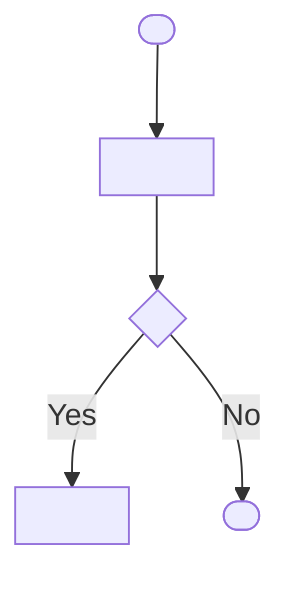
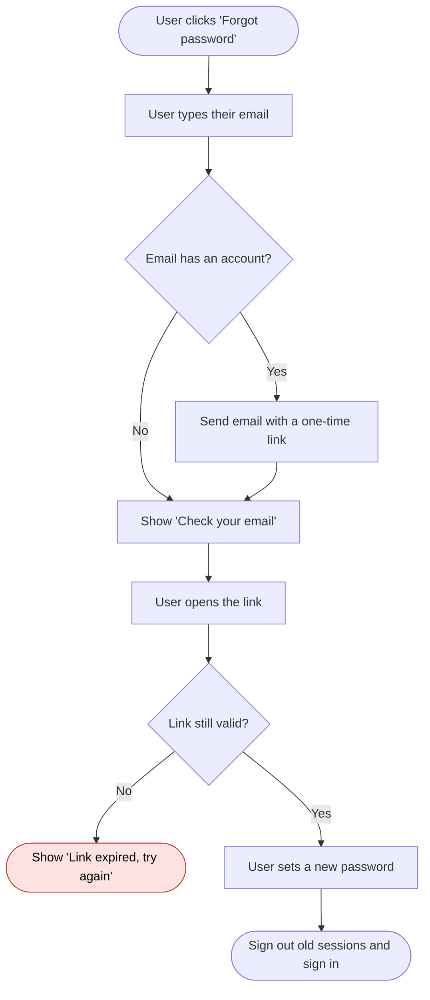

# Condensed plans

A good plan is short. It shows **what the feature does** first, in a picture that anyone
can read. Then it shows how you will build it, in small steps. It uses easy words.

You do the engineering work in your head first (part A). You write only the results
(part B). The reader sees one page, not your notes.

## Part A — Think first (do not write all of this down)

Do these steps in order. Read the code before you decide anything.

1. **Understand the problem.** Who has the problem? What do they do today? What does
   "success" look like for them? If you cannot say this in two sentences, ask the user.
2. **Read the code.** Find the parts that already exist. Reuse them. Find the place where
   the new code fits. Find the tests that cover this area.
3. **Write the requirements.**
   - **Must:** what the feature must do.
   - **Must not:** what it must never do (leak data, break an old API, slow down a page).
   - **Quality needs:** only the ones that matter here — speed, security, data safety,
     scale, access rules.
4. **Write acceptance criteria.** Each one is a test you can run: *"When X, then Y."* If you
   cannot test it, rewrite it.
5. **Design the smallest safe change.** Check each point:
   - **One job per part.** Keep each change in the layer that owns it.
   - **Contracts first.** Decide the data shapes and the API before the code.
   - **Old callers keep working.** Do not break an existing API, schema or file format.
   - **Fail safe.** On an error, block or stop. Do not let bad data through.
   - **Trust boundaries.** Note where input comes from outside, and who may call what.
   - **See it in production.** Decide what to log or measure.
   - **Undo.** Decide how to switch it off (a flag) or roll it back.
   - **No extras.** Build only what the requirements need (YAGNI).
6. **Find the risks.** List what can go wrong. Put the riskiest work in an early slice, so
   you learn early.
7. **Cut vertical slices.** Each slice does one thing end to end and passes the gate alone
   (see `gate-driven-slices`). Slice 1 is often a "walking skeleton": the ends connected,
   with stubs in the middle.
8. **List open questions.** Do not guess an answer that only the user knows. Ask.

## Part B — Write the plan

Use this order. **The flowchart is always first.**

````markdown
## <Feature name>

### What the feature does


### Why
<1–2 sentences: the problem, and who has it.>

### Requirements
- **Must:** <…>
- **Must not:** <…>
- **Quality:** <only the ones that matter>

### Done when
1. When <action>, then <result>.
2. When <action>, then <result>.

### Design
| Part | Change | Why |
|---|---|---|
| <file or module> | <what changes> | <the reason> |

### Slices
| # | Slice | Done when |
|---|---|---|
| 1 | <walking skeleton or riskiest part> | <a result you can see> |
| 2 | <…> | <…> |

### Next: slice 1
- **Files:** <the few files>
- **Test first:** <the test that proves it>
- **Risk:** <the main risk>

### Risks and undo
- <risk> → <what you do about it>
- **Undo:** <flag off, or revert the commit>

### Check
<the gate command, and any check by hand>

### Questions
- <only questions that block the work>
````

## Flowchart rules

The first chart shows **what the feature does for the user**. It does not show the code.

- Use `flowchart TD` (top to bottom).
- Use **10 boxes or fewer**. If you need more, the feature is too big. Cut it.
- Use the right shape for each box:
  - `([ ])` round box: start and end.
  - `[ ]` box: a step.
  - `{ }` diamond: a question with two answers.
- Write each box as a short action: **2 to 6 words**, verb first ("Send email with link").
- Write each question as a question ("Link still valid?"). Label the arrows **Yes** and **No**.
- Show the error path. A reader must see what happens when something fails.
- Use no code names, class names or table names in this chart.
- Put the text in quotes when it has brackets or quotes: `A(["User clicks 'Reset'"])`.
- Optional: color the error ends. Set a text color so the chart works in dark mode:
  `classDef stop fill:#fde2e2,stroke:#c0392b,color:#000` and `class H stop`.

A second, technical chart (for example a `sequenceDiagram` of services) is allowed in
**Design**. Add it only when three or more parts talk to each other.

## Language rules (Simplified Technical English)

Write the whole plan in easy, plain English. A reader who speaks English as a second
language must understand it on the first read.

| Rule | Do | Do not |
|---|---|---|
| Short sentences | 20 words or fewer for a step. 25 or fewer for a description. | Long sentences with many clauses. |
| One idea per sentence | "Send the email. Then show the message." | "Send the email and, once that's done, show the message." |
| Active voice | "The system sends the link." | "The link is sent by the system." |
| Commands for steps | "Add a test." | "A test should be added." |
| Easy words | See the table below. | Rare or long words. |
| Same word, same meaning | Use "link" every time. | "link", then "URL", then "token". |
| Explain a technical term once | "rate limit (a maximum number of requests per minute)" | A term with no explanation. |
| No idioms or slang | "This is easy." | "This is a no-brainer." |
| No semicolons | Two sentences. | One sentence with a semicolon. |
| Numbers as digits | "3 retries" | "three retries" |

### Easy words

| Use | Not |
|---|---|
| use | utilize, leverage |
| start | initiate, commence |
| stop, end | terminate |
| make sure | ensure |
| help | facilitate |
| show | display, surface |
| get | retrieve, obtain |
| change | modify |
| need | require |
| more than | in excess of |
| about | approximately |
| because | due to the fact that |
| before | prior to |
| part | component (except in the Design table) |

Keep a technical word when no easy word is correct (API, database, test, commit).

## Rules
- **One page.** If the plan is longer, cut detail from later slices.
- **Detail only the next slice.** Later slices stay one row each until they are next.
- **Revise, don't append.** When you learn something new, change the plan. Keep findings in
  the plan, not in chat.
- **No plan for a tiny change.** A one-file fix needs one sentence.

## Done
- The flowchart comes first, has 10 boxes or fewer, and shows the error path.
- Every "Done when" line is a test you can run.
- Every slice passes the gate alone.
- The text follows the language rules.
- The user can read it in 1 minute and say "yes", "no" or "change slice 2".

## Example

````markdown
## Password reset by email

### What the feature does


### Why
Users who forget their password must email support today. Support resets about 40
passwords each week by hand.

### Requirements
- **Must:** send a link that works 1 time and expires after 30 minutes.
- **Must not:** tell the user if an email has an account. Show the same message for both.
- **Quality:** limit requests to 5 per hour for each email. Store only a hash of the link token.

### Done when
1. When a known email asks for a reset, then 1 email with a link is sent.
2. When an unknown email asks, then no email is sent and the same message shows.
3. When a link is older than 30 minutes, then it fails with "Link expired".
4. When a link is used 2 times, then the second use fails.
5. When the password changes, then all old sessions end.

### Design
| Part | Change | Why |
|---|---|---|
| `reset_tokens` table | New table: user, token hash, expiry, used | Store links safely |
| `POST /password/forgot` | New endpoint | Start the reset |
| `POST /password/reset` | New endpoint | Set the new password |
| Email service | New "reset" template | Send the link |
| Feature flag `password_reset` | Off by default | Switch it off fast |

### Slices
| # | Slice | Done when |
|---|---|---|
| 1 | Token table and token rules (create, check, use once) | Tests 3 and 4 pass |
| 2 | Forgot endpoint and email, behind the flag | Tests 1 and 2 pass |
| 3 | Reset endpoint, end old sessions | Test 5 passes |
| 4 | Rate limit and logs | 6th request in 1 hour is blocked |

### Next: slice 1
- **Files:** a new migration, `auth/reset_tokens.py`, `tests/auth/test_reset_tokens.py`
- **Test first:** an expired token fails, and a used token fails.
- **Risk:** the clock in tests. Use a fixed clock.

### Risks and undo
- An attacker finds which emails have accounts → same message and same timing for both.
- A link leaks in logs → never log the token. Log only the user id.
- **Undo:** set `password_reset` off. Slice 1 adds a table only, so it is safe to keep.

### Check
`scripts/check.sh`, then one reset by hand on a local copy.

### Questions
- Is 30 minutes the right expiry?
````
