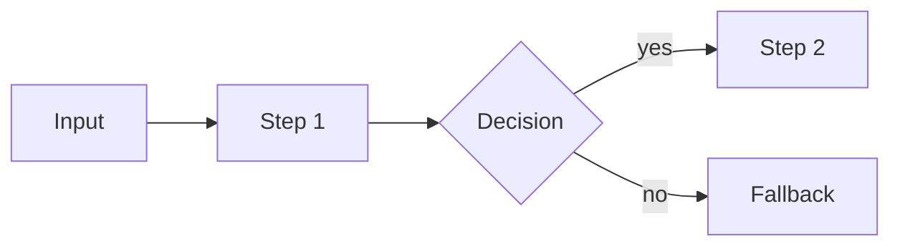

# Condensed plans

A long plan buries the decisions. A condensed plan shows the shape of the work at a glance,
details only what happens next, and changes as you learn.

## Shape

````markdown
## <Feature>

<Two lines of context: what and why.>



| # | Slice | Done when |
|---|---|---|
| 1 | Walking skeleton: wire ends with stubs | gate green, stub test passes |
| 2 | <next slice> | <observable result> |
| 3 | <…> | <…> |

### Slice 1 (next)
- Files: <the few files it touches>
- Test first: <the test that will prove it>
- Risk: <the one thing most likely to go wrong>

### Verify
<the gate command, plus any manual check>
````

## Rules
- **Context:** two lines. If you need more, the feature is not understood yet — explore first.
- **Diagram:** one mermaid flowchart of the *runtime* workflow (how data and control move),
  not of the project schedule. Keep it under ~12 nodes.
- **Slice table:** each slice passes the gate on its own (see `gate-driven-slices`). The
  "Done when" column is observable, not "implemented".
- **Detail only the next slice.** Later slices stay one row each until they are next.
- **Revise.** When exploration changes the picture, update the plan, don't append to it.
  Keep findings in the plan, not scattered in chat.
- **No ceremony for small changes.** A one-file fix needs a sentence, not a plan.

## Done
The user can read the plan in under a minute and say yes, no, or "change slice 2".

## Example
A data-redaction feature plan fits this shape: two lines on what leaves the system and
why it must be redacted, a flowchart (tool result → detectors → engine → policy → model or
blocked), a slice table (detectors → engine → wiring behind a flag → enforce
mode), and detail only for the detectors slice. A standing team preference: *"targeted and
small plans … condensed … make graphical representations of workflow."*
