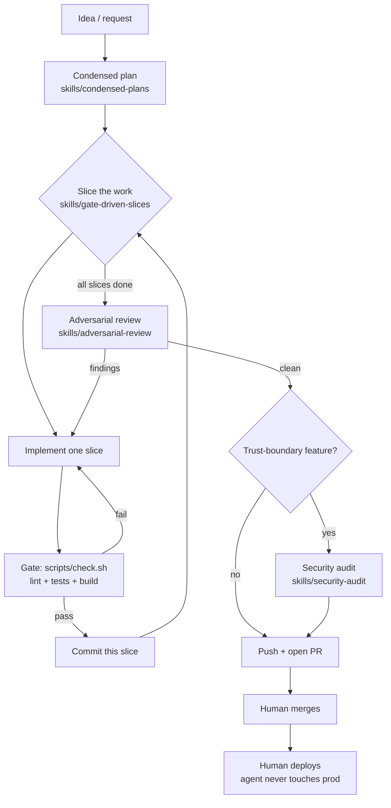

# The workflow

How a change moves from idea to shipped, and where each skill and template fits. The spine
is: **small plan → vertical slices, each passing the gate → adversarial review → PR → human
merge and deploy**, with a security audit for boundary features.

## Stages

1. **Plan** — think through requirements, acceptance criteria, design, risks and slices.
   Write one page: a flowchart of what the feature does first, then why, requirements,
   "done when" tests, design, slices, and detail for the next slice only. Use easy English.
   → `skills/condensed-plans`.

2. **Slice & build** — take the front slice, implement it, run the gate, commit. Repeat. The
   gate (`skills/adopt/templates/scripts/check.sh`) is the definition of done for each slice. →
   `skills/gate-driven-slices`.

3. **Review** — when the feature is developer-done, run the adversarial review (review-only by
   default). Fix critical/major findings; record disputes. → `skills/adversarial-review`.

4. **Security audit** — for anything on a real trust boundary (auth, crypto, tenant
   isolation, data leaving the system), run the dedicated audit. Findings are evidence-first;
   unproven ones are `needs_validation` with no severity. → `skills/security-audit`.

5. **PR** — push the branch, open a PR that states what changed, how it was verified, and any
   caveats (e.g. "safe to merge behind a flag; validate X before enabling in prod").

6. **Merge & deploy** — **a human does both.** The agent's permission config denies deploy
   and infra commands outright.

## Upstream of code: the SDLC pipeline (optional)

For greenfield work, a longer pipeline runs before any of the above: requirements →
architecture → UX foundations → implementation plan → scaffolding → per-feature detailed
design → UI design → implementation → acceptance verification. Those phases are their own
skills in a full agent setup; this repo focuses on the **construction and shipping loop** that
applies to every change, greenfield or not.

## The two artifacts that carry the most weight

- **`skills/adopt/templates/AGENTS.md`** — the agent's standing instructions. If an agent reads nothing
  else, it reads this.
- **`skills/adopt/templates/scripts/check.sh`** — the one command that decides "done".

Get those two right for your repo and most of the rest follows.
